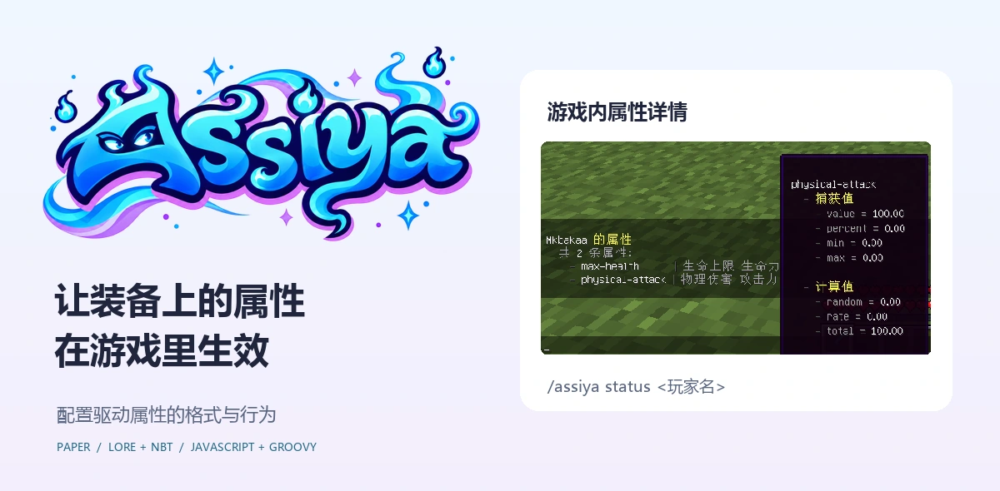
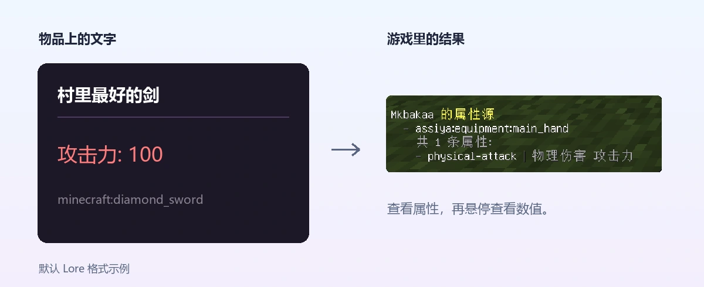

<p align="center">
  <picture>
    <source media="(prefers-color-scheme: dark)" srcset=".github/assets/readme/hero-dark.webp">
    
  </picture>
</p>

<p align="center">面向 RPG 玩法的 Minecraft 属性插件，运行于 Paper 系服务端(包括 Folia)</p>

<p align="center">
  
  
  <a href="LICENSE"></a>
</p>

<p align="center">
  <a href="https://mkbakaa.cn/content/guide/intro.html">项目介绍</a>&ensp;·&ensp;<a href="https://mkbakaa.cn/content/guide/quick-start.html">快速开始</a>&ensp;·&ensp;<a href="https://mkbakaa.cn/content/mythicmobs/mob-attributes.html">MythicMobs</a>
</p>

<p align="center">
  <a href="https://qm.qq.com/q/ipJqBPMpji">点击加入交流群</a>
</p>

<p align="center">
  
</p>

<br>

<h3 align="center">物品上写属性，游戏里看结果</h3>

<p align="center">默认配置下，在 Lore 中写入 <code>攻击力: 100</code>，手持物品就能读取。</p>

<p align="center">
  <picture>
    <source media="(prefers-color-scheme: dark)" srcset=".github/assets/readme/reading-dark.webp">
    
  </picture>
</p>

<p align="center">
  执行 <code>/assiya status &lt;玩家名&gt;</code> 查看当前属性，悬停查看读到的数值和计算结果。<br>
  <sub>百分比、随机范围和自定义格式的写法，见<a href="https://mkbakaa.cn/content/guide/quick-start.html">为物品添加属性</a>。</sub>
</p>

<br>

<h3 align="center">读取格式和生效条件，由你定义</h3>

<p align="center">
  从 Lore 或 NBT 读取属性，通过读取组定义数值格式。<br>
  穿戴等级、槽位限制、计算公式，都可以按服务器的玩法配置。
</p>

<p align="center">
  <a href="https://mkbakaa.cn/content/config/readers.html">读取组与自定义格式</a>&emsp;·&emsp;<a href="https://mkbakaa.cn/content/config/conditions.html">使用条件与生效范围</a>
</p>

<br>

<h3 align="center">属性生效时做什么，用脚本来写</h3>

<p align="center">
  内置 JavaScript 和 Groovy 支持，用脚本编写战斗属性和触发行为。<br>
  同时提供 MythicMobs 4 / 5 的怪物属性、技能机制、条件与占位符。
</p>

<p align="center">
  <a href="https://mkbakaa.cn/content/tutorial/attribute.html">编写一个增伤属性</a>&emsp;·&emsp;<a href="https://mkbakaa.cn/content/mythicmobs/mob-attributes.html">为 MythicMobs 怪物添加属性</a>
</p>

<br>

<p align="center">
  
</p>

<a id="download"></a>
<h3 align="center">下载 Assiya</h3>

<p align="center">前往 <a href="https://github.com/MkbaKa/Assiya/releases/latest">GitHub Releases</a> 下载。</p>

<p align="center">
  <a href="https://github.com/MkbaKa/Assiya/releases/latest"></a>
</p>

<p align="center">
  <sub>首次使用请先阅读<a href="https://mkbakaa.cn/content/guide/quick-start.html">快速开始</a>，了解依赖插件与安装步骤。</sub>
</p>

<br>

<h3 align="center">开发时依赖</h3>

<details>
<summary>Gradle Kotlin DSL</summary>

```kotlin
repositories {
    maven("https://jitpack.io")
}

dependencies {
    compileOnly("com.github.MkbaKa:Assiya:assiya-v0.0.4") {
        isTransitive = false
    }
}
```

</details>

<details>
<summary>Maven</summary>

```xml
<repositories>
    <repository>
        <id>jitpack</id>
        <url>https://jitpack.io</url>
    </repository>
</repositories>

<dependencies>
    <dependency>
        <groupId>com.github.MkbaKa</groupId>
        <artifactId>Assiya</artifactId>
        <version>assiya-v0.0.4</version>
        <scope>provided</scope>
        <exclusions>
            <exclusion>
                <groupId>*</groupId>
                <artifactId>*</artifactId>
            </exclusion>
        </exclusions>
    </dependency>
</dependencies>
```

</details>

<br>

<h3 align="center">鸣谢与许可证</h3>

<p align="center">
  <a href="https://github.com/Skillw/AttributeSystem">AttributeSystem</a>：读取组与 NBT 结构的设计参考。<br>
  Assiya 插件代码采用 <a href="./LICENSE">GPL v3 开源协议</a>
</p>
