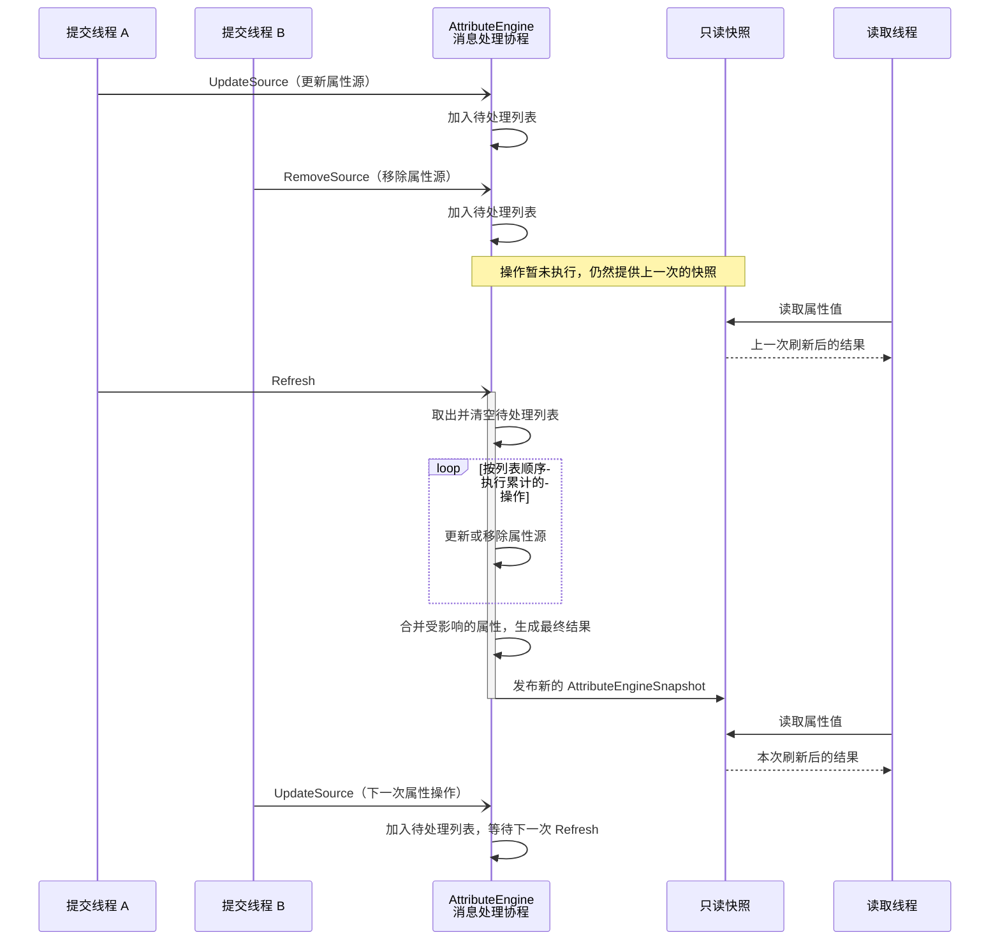

# 属性管理

调用 `AssiaAPI.addAttribute` 后，经过解析、条件判断的结果会交由一个叫做 `AttributeEngine` 的东西调度执行。

它是一个消息队列实现，负责把各个线程发来的属性操作压到一个消息处理线程执行，不需要依赖锁也能保证线程安全。

正常情况下，除 `Refresh` 以外的消息(即 `AttributeEngineAction`)只会不断累计在待处理列表中，直到 `Refresh` 消息被消费。

`Refresh` 就像一个闹钟，通知队列里的消息到点上班，执行它们对应的属性操作。

其大概时序如下：

当累计的命令消费完后，`AttributeEngine` 会根据这次影响的所有属性源/值计算出一份最终结果，也就是 `AttributeEngineSnapshot` 属性快照。

属性快照只提供无锁的属性值读取，不提供任何写操作，不会存在竞态条件。

这两者构成了一个完全无锁、足以覆盖大部分并发场景的属性值管理。
