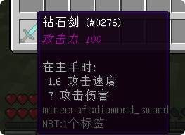
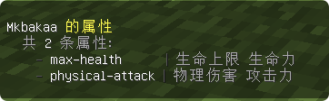
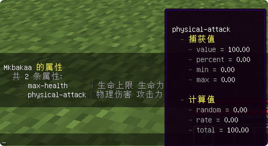

# 物品属性

## 物品上的属性来源

Assiya 本体提供了两种基于物品的读取方式。
分别是：
- Lore
  - 即物品描述，读取格式由[读取](TODO)定义。
- NBT
  - 玩家不可见的物品标签，格式固定。

## 为物品增加属性

### 前言

为了方便理解，本节提到的一切格式均基于未更改的默认配置编写。  

不浪费篇幅展开解释默认配置是如何定义、运行的。  

示例会基于更简单的 Lore 来描述，而不是较为复杂的 NBT 概念。   

如果你认为这是一篇宝宝巴士教你上厕所秘诀，可以直接跳到[读取配置](TODO)。

## 村里最好的剑

假设我们想要给一件物品增加 100 点攻击力。  

可以通过一些手段（如 Lore 编辑插件、物品库等）给物品增加一条描述，  

这样你就获得了一把村里最好的剑！



## 我该怎么知道属性有没有生效？

非常简单，可以在**手持这把剑的情况下**，执行命令
```text
/assiya status <你自己的玩家名>
```

聊天框会弹出如下提示：


将鼠标指针移动到攻击力对应的条目上就能看到这条属性对应的数值，  

以及组成最终结果的过程：


## 为什么图片里多出来一行生命力？

生命力是[默认配置](TODO)内提供的默认属性，天然就在你的属性数据中。

## 为什么上面的图片中只有 value 和 total 有数值，其他的都是 0.00 ？

这一点属于[读取组](TODO)相关的知识，涉及到的内容比较复杂。  

如果无法理解，可以尝试让 AI 阅读后帮你解释。

## 下一步

- 不关心复杂的读取逻辑，可以了解一下 Assiya 提供的[全局设置](../configuration/global.md)。
- 只有一个攻击力显然不够，或者它不是我想要的命名，可以在[属性配置](TODO)找到想要的内容。