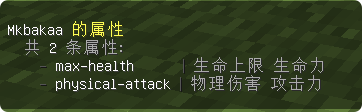
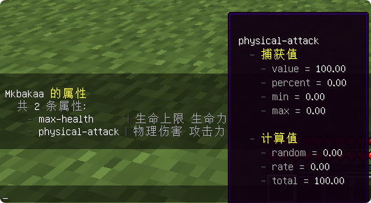

# 为物品添加属性

::: info 前言
为了方便理解，本节提到的一切格式均基于未修改的默认配置编写，且基于更直观的 **Lore** 来描述，而不是较为复杂的 [NBT 结构](../config/nbt.md)。

如果你认为这是一篇宝宝巴士教你上厕所秘诀，可以直接跳到 [读取组与自定义格式](../config/readers.md)。
:::

## 村里最好的剑

假设我们想要给一件物品增加攻击力和暴击几率。

可以通过任意手段（如 Lore 编辑命令、物品库插件等）给物品增加几行描述：

~~颜色不影响解析~~

<McTooltip
  name="&f村里最好的剑"
  :lines="[
    { text: '&c攻击力: 100', note: '固定数值', status: 'ok' },
    { text: '&c攻击力: 50%', note: '百分比加成', status: 'ok' },
    { text: '&6暴击几率: 25%', note: '固定数值', status: 'ok' },
    { text: '&8minecraft:diamond_sword' },
  ]"
/>

### 为什么暴击几率和攻击力都有百分号，但暴击几率是固定数值？

因为`暴击几率`使用的是 `percent` 读取组，而`攻击力`使用 `default`。

这两个读取组的区别会在[读取组页面](../config/readers.md)中提到。

## 我该怎么知道属性有没有生效？

非常简单，在**手持这把剑的情况下**，执行命令：

```text
/assiya status <玩家名>
```

聊天框会列出你当前生效的所有属性。将鼠标指针移动到聊天框里 `攻击力` 对应的条目上，就能看到这条属性读到的各个数值，以及算出来的 `total`（最终结果）。




<FlowSteps
  :columns="2"
  :steps="[
    { tag: 'Q1', title: '为什么多出来一行生命上限？', desc: '<code>生命上限 100</code> 是 <code>config.yml</code> 里 <code>default-attributes.player</code> 给玩家配的默认属性，进服自带。不需要的话去 <code>config.yml</code> 里注释掉就行。' },
    { tag: 'Q2', title: '为什么 min 和 max 是 0.00？', desc: '默认读取组支持三种写法：固定值（读入 <code>value</code>）、百分比（读入 <code>percent</code>）、随机范围（如 <code>10-20</code>，读入 <code>min</code> 和 <code>max</code>）。上面没写范围，所以是 0。' }
  ]"
/>

## 下一步

- 好奇默认配置里都有哪些现成属性？见 [默认属性与条件](../config/defaults.md)。
- 想给物品加上穿戴等级、职业或槽位限制？见 [使用条件与生效范围](../config/conditions.md)。
- 不想做物品，直接用命令给玩家加临时属性？见下一篇 [命令](./commands.md)。
