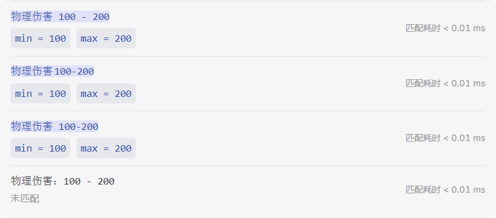
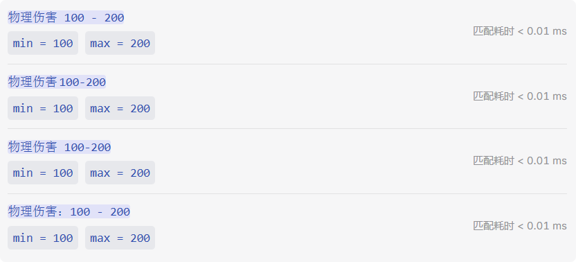

# 增加一条新的读取格式

通常来讲，如果你的需求仅仅只是增加一种读取规则，并不需要编写一个新的读取组。

大部分读取方式或是捕获组都已经在 `default` 中提供了，完全可以复用它。

## 增加一种格式

在编写规则前首先要明确自己想要的格式在最终属性值的计算中，负责哪个部分。

比如`普通的增加数值`、`百分比增加数值`、`范围值的下限/上限`。

在 `default` 读取组中，都有它们对应的捕获组：`value`、`percent`、`min/max`，而单纯的增加格式，而不增加新的算式，直接复用即可。

假设 `default` 现在并没有 `物理伤害 100 - 200` 这种读取格式，那么我们想要实现它，就要搞清楚

- 数值对应的捕获组（需要新增或者用现成的？）
- 正则匹配格式

### 我们想要增加的范围值是普通叠加数值，是不是可以用 `value` ?

答案是不可以，因为 Assiya 在处理配置加载时，会把正则里的普通捕获组名称替换成对应的`正则捕获组`，重复的捕获组名称会报错。

### 那该怎么做？

首先我们看数字部分，`100 - 200` 有很明显的`最小值`与`最大值`两个特征对吧？

那么我们就可以为它们创建不同的捕获组，这里叫做 `min` 和 `max`。

捕获组搞清楚了，是不是就该写对应的匹配规则了？

在 Assiya 的正则表达式中，会把 `{name}` 替换为属性的读取名，`<xxx>` 替换为捕获组。

那么我们就得出了一条没有使用正则表达式语法，但符合读取需求的格式：

```text
{name} <min> - <max>
```

如果只是单纯这样写，则文本必须严格遵守`物理伤害 100 - 200`(包括空格)这种格式才能匹配通过，任何一点细微的差异都不能正确匹配。

#### 规则测试 

可以在这个框框里测试这条规则，不过这里的耗时是浏览器里模拟的展示数据，不是服务器里的真实数据：

<RegexTester
  initial-pattern="{name} <min> - <max>"
  initial-name="物理伤害"
  :initial-lines="['物理伤害 100 - 200', '物理伤害100-200', '物理伤害 100-200', '物理伤害：100 - 200']"
  :captures="{ min: '[-+]?\\d+(?:\\.\\d+)?', max: '[-+]?\\d+(?:\\.\\d+)?' }"
/>

严格的匹配带来了更高的匹配效率，但我们平常使用并不会过度追求这一点开销，稍微宽松一点反而更便于使用。

而我们平常可能不太会在意空格的存在，那么就可以在这条推导出格式的基础上，加入正则表达式中的**空格匹配**：`\s`

```text
{name}\s<min>\s-\s<max>
```

但单纯把空格替换为表达式语法并没有改变什么，匹配规则还是和原来一样。

所以要进一步引入`数量限定`符号：`*`；`*` 代表了**前面的规则可以满足零次或多次**，也就是**可选规则**。

于是我们把规则变成了

```text
{name}\s*<min>\s*-\s*<max>
```

那我们复制这段规则，再回过头粘贴进[规则测试](#规则测试)里的读取格式框里，会发现第二、三条文本也可以匹配成功了。



为什么第四条规则没有匹配成功呢？ 因为 `\s*` 只能代指**空格可选**，并不能匹配属性名和数值之间的冒号。

既然我们已经知道了怎么让空格参与匹配规则，那么举一反三，冒号是不是也可以这样写？答案是正确的。

我们可以这样把半角、全角、空格都纳入匹配规则中：

```text
{name}:*：*\s*<min>\s*-\s*<max>
```

这样，第四条文本也可以正常通过匹配了。



不过你会不会觉得这条规则看起来很臃肿？中间为了让冒号与空格也参与规则，写了好几个可选 `*` 号。

那么我们就可以通过`规则组`来把它们三个变成同一条规则(也就是用`[]`包裹)，再让这一整个组变为可选：

```text
{name}[\s:：]*<min>\s*-\s*<max>
```

同样能够完美匹配四条文本，大功告成！

## 我的需求并不是增加一条规则能够解决的，我该怎么办？

我的建议是让 AI 阅读 `default` 与 `percent` 先搞清楚如何编写读取组、以及如何满足 `percent` 和 `default` 的差异；然后把你的需求告诉它，让它给你生成。
