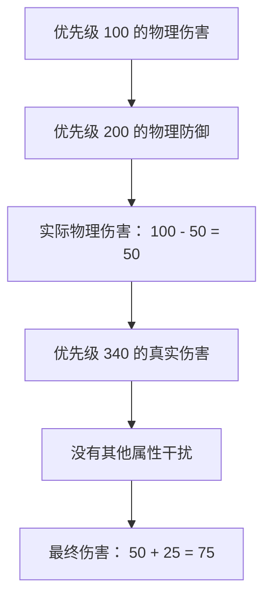

# 伤害类触发

正常情况下，一次完整的伤害需要`攻击方`与`受击方`两者参与才能组成一次正常的进攻逻辑。~~（自残行为除外）~~

而攻击方对应的触发器就是 `attack`，受击方对应 `defense`。

既然是进攻，那么就一定会有防守，所以 `attack` 和 `defense` 并不是互相单独触发的。

假设你拥有 100 点物理伤害与 25 点真实伤害，对方拥有 50 点物理防御，那么实际情况应该是：

非常的简单易懂。